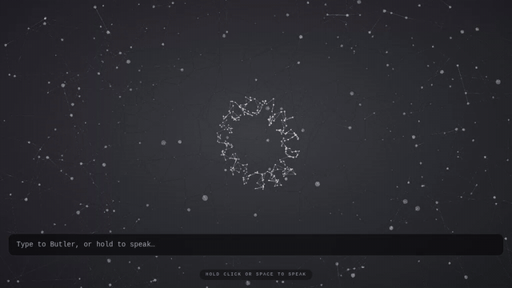

# Butler

A self-hosted voice assistant with a living particle avatar. Bring any OpenAI-compatible model and talk to it in your browser.



- **Talk or type:** hold click or space to speak, say the wake word, or use the chat box.
- **Any model:** Ollama, OpenAI or anything with a streaming `/chat/completions`.
- **Answers out loud:** it starts speaking while the model is still writing.
- **Tools:** connect MCP servers and the model can use them.

Built with Nuxt, Vue, TypeScript and three.js.

## Run it

You need Node 22 or newer and [pnpm](https://pnpm.io).

```bash
pnpm install
cp .env.example .env
```

Point `.env` at your model, then start it:

```bash
# .env, for Ollama
LLM_BASE_URL=http://localhost:11434/v1
LLM_MODEL=qwen2.5:7b
```

```bash
pnpm dev
```

Open <http://localhost:3000>. For a hosted provider, change the base URL and model and add `LLM_API_KEY`.

For voice, set `STT_BASE_URL` and `TTS_BASE_URL` to anything with OpenAI-style audio endpoints, such as [Speaches](https://github.com/speaches-ai/speaches). `.env.example` lists every option.

Tool support varies by model. If replies wander, try a stronger model.

Optional request settings, each sent only when set:

- `LLM_SYSTEM_PROMPT`: a system message. Leave it empty for a server that brings its own prompt.
- `LLM_LOCALE`: sent as `metadata.locale`, for servers that localise their replies.
- `LLM_USER`: sent as the OpenAI `user` field. With login on (see Safety) the signed-in user's OIDC subject id is sent instead, never a name or email.
- `LLM_PERSONA_EVENTS`: `1` sends `x-persona-events: 1`, so a persona server adds its named events and the tools it runs itself show as they run. Leave it empty for any other server.

If your server runs tools itself and streams `persona.tool_activity` events (`{"name": "...", "phase": "start" | "end", "label": "..."}`), Butler shows them like its own tool calls. Servers that don't send them are unaffected.

## Tools

Set `MCP_SERVERS` to JSON, or to a path to a JSON file:

```json
{
  "time": { "command": "uvx", "args": ["mcp-server-time"] },
  "notes": { "url": "https://mcp.example.com/mcp", "headers": { "Authorization": "Bearer your-token" } }
}
```

## Safety

Butler has no login unless you set `OIDC_ISSUER`, so keep it on a trusted network.

With `OIDC_ISSUER` set, every page, API call and the `/ws` socket needs a session from your OpenID Connect provider (authorization code with PKCE, tested against Authentik). Only `/api/health` and the `/auth/*` routes stay open.

```bash
OIDC_ISSUER=https://authentik.example.com/application/o/butler/
OIDC_CLIENT_ID=...
OIDC_CLIENT_SECRET=...
OIDC_REDIRECT_URI=https://butler.example.com/auth/callback
OIDC_ALLOWED_GROUPS=butler-owners
SESSION_SECRET=...   # 32+ characters
```

- Register `OIDC_REDIRECT_URI` as the redirect URI, and `https://butler.example.com/` as a post-logout redirect URI.
- Members of `OIDC_ALLOWED_GROUPS` get in, read from the `groups` claim. Leave it empty to admit anyone the provider signs in.
- Sessions last 7 days. The public origin comes from `OIDC_REDIRECT_URI`, not the `Host` header, so it works behind a reverse proxy.

## License

MIT. See [LICENSE](LICENSE).
