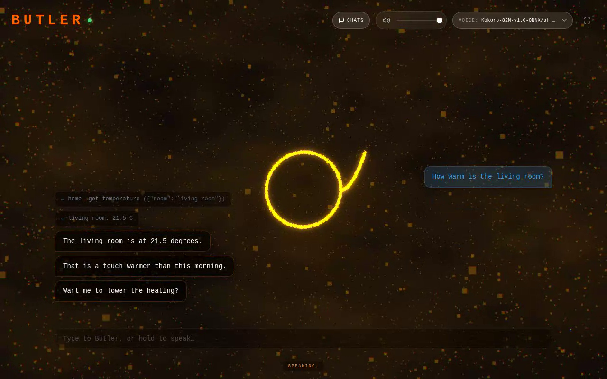
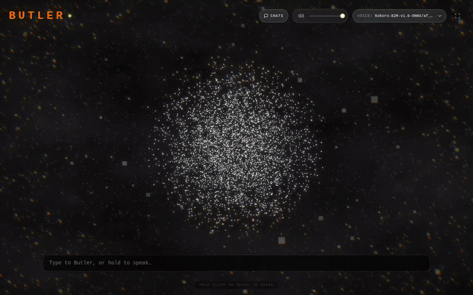

# Butler

A self-hosted voice assistant with a living particle avatar. Bring any OpenAI-compatible model, talk to it in the browser, and watch 12,000 GPU particles fold into a new shape for each thing it does. Add tools through MCP, or leave them out and have a plain voice chat.





*Recorded against the bundled mock server, which is also how you can try it with no model at all.*

## What it does

- **Talk or type.** Hold click or space to speak, say the wake word hands-free, or type in the chat box.
- **Hears you, answers out loud.** Speech to text, chat and text to speech each go to their own OpenAI-shaped endpoint, so you can mix local and hosted services freely.
- **Speaks while it streams.** Each paragraph is synthesized the moment the model finishes it, so the first words play long before the reply is complete.
- **Uses tools.** Connect MCP servers over HTTP or stdio and the model can call them. Calls and results appear in the chat log as they happen.
- **Remembers threads.** Every visit starts clean. The first message opens a thread, `?c=<id>` reopens it, and threads are plain JSON files you own.

## How it works

```
Browser                                    Nuxt server (Nitro)
┌───────────────────────────┐              ┌──────────────────────────────┐
│ Silero VAD, MediaRecorder │  audio/text  │ pipeline: STT, LLM, TTS      │──▶ /audio/transcriptions
│ Web Audio analyser        │ ───────────▶ │ tool loop                    │──▶ /chat/completions
│ Three.js particle avatar  │ ◀─────────── │ conversation store (JSON)    │──▶ /audio/speech
└───────────────────────────┘  WS events   │ MCP client                   │──▶ MCP servers
                                           └──────────────────────────────┘
```

One Nuxt 3 app holds both sides. A single WebSocket carries audio up and typed events down.

## The engineering

### The avatar

The avatar lives in a vertex shader. Each particle has a home position in a sphere, plus a "from" and a "to" position in the current shape. The CPU only sets a few uniforms per frame, and the GPU blends `home -> shape` by `u_condense` and `from -> to` by `u_shapeMorph`.

- **Shapes are data, not meshes.** `utils/shapes.ts` samples a ring, triangle, cube, infinity sign, pi, alpha and omega into point clouds. The 35% of particles closest to the center take shape slots, the rest float free. A morph only rewrites the two attribute buffers.
- **Every state is a target.** `useAvatarState` resolves each state (idle, listening, thinking, speaking) into a flat set of numbers and moves toward them with `1 - exp(-8 * dt)`, so transitions look identical at any frame rate. Speaking picks a random shape, never the same one twice in a row.
- **It reacts to the actual voice.** Playback runs through an `AnalyserNode` placed before the gain node, so the visuals don't change with the volume slider. Energy pushes only the free particles outward, which keeps the shape crisp while the cloud around it breathes.
- **It scales down gracefully.** Device detection reads the GPU name from `WEBGL_debug_renderer_info` once at startup. Phones and small screens get 3,000 particles and no post-processing, integrated GPUs get 7,000 and capped pixel density, and dedicated GPUs get 12,000 with chromatic aberration, a nebula shader and a custom heat-haze effect.

### Streaming speech

Reply latency in a voice app is the time to the first spoken word, not the last. `server/utils/llm.ts` splits the token stream on newlines into paragraph blocks and hands each finished paragraph to TTS at once. Synthesis calls go through a promise chain so audio always arrives in order, and the browser queues clips so one never cuts off another.

The UI sees the same structure: typed block events (`message`, `tool_call`, `tool_output`) that a client can render incrementally.

### Surviving real OpenAI-compatible servers

"OpenAI-compatible" covers a lot of ground, and the parser is written and tested for the differences:

- Tool calls may arrive split across many chunks or whole, with `id` on the first fragment only, with `index` missing or reused, or with arguments as an object instead of a string.
- Tool calls can come with `finish_reason: "stop"`, so the loop trusts the calls, not the reason.
- Usage may be absent, keepalive comments and vendor-specific named events may appear mid-stream, and some servers ignore `stream: true` and return plain JSON.
- A stall timer watches every byte rather than the whole request, so a long tool run behind a server with keepalives survives while a dead connection doesn't.

If the browser disconnects mid-reply, the upstream request is cancelled, so an abandoned turn doesn't keep generating.

### The tool loop

Model, tool calls, execute, feed results back, model again. Calls run in order, because "turn off the heating, then read the temperature" must not race. Failures, unknown tools and malformed arguments go back to the model as tool results so it can recover or explain. At the iteration cap the model gets one final call with no tools, which guarantees an answer rather than a silent stop.

MCP servers connect independently. One that fails is logged and skipped, and it is retried on later turns. A call that fails is not retried, because it may already have changed something in the real world.

### Listening without an always-on stream

In passive mode Silero VAD runs in the browser in WebAssembly, and only finished utterances go to the server for transcription. "Butler, turn on the lights" runs at once; "Butler" alone opens a listening window. Short noise and the phrases Whisper tends to invent for silence are discarded before they reach the model.

### Storage

Threads are one JSON file each. Writes go to a temp file, sync, then rename, so a crash can't leave a half-written thread. Each thread has its own write queue, so concurrent appends can't drop a message. Ids are validated before they become file names. Because chat completions is stateless, the recent history is sent with every request, trimmed to a budget and always starting on a user turn.

## Quick start

You need Node 22 or newer and [pnpm](https://pnpm.io).

```bash
pnpm install
cp .env.example .env
```

### Try it with no model

The test mock doubles as a demo backend. It costs nothing and needs no GPU.

```bash
pnpm mock
```

In a second terminal:

```bash
LLM_BASE_URL=http://127.0.0.1:4010/v1 LLM_MODEL=mock \
TTS_BASE_URL=http://127.0.0.1:4010/v1 TTS_RESPONSE_FORMAT=wav STT_BASE_URL= \
pnpm dev
```

Open <http://localhost:3000> and type something.

### With Ollama

```bash
ollama pull qwen2.5:7b
```

```bash
# .env
LLM_BASE_URL=http://localhost:11434/v1
LLM_MODEL=qwen2.5:7b
```

Ollama has no speech endpoints. For voice, run [Speaches](https://github.com/speaches-ai/speaches), which serves both STT and TTS, and point `STT_BASE_URL` and `TTS_BASE_URL` at it. Leave both empty and Butler works as a silent typed chat.

```bash
pnpm dev
```

### With OpenAI or a compatible provider

```bash
# .env
LLM_BASE_URL=https://api.openai.com/v1
LLM_API_KEY=sk-...
LLM_MODEL=gpt-4o-mini

STT_BASE_URL=https://api.openai.com/v1
STT_API_KEY=sk-...
STT_MODEL=whisper-1

TTS_BASE_URL=https://api.openai.com/v1
TTS_API_KEY=sk-...
TTS_MODEL=tts-1
TTS_VOICE=alloy
```

Any server with a streaming `/chat/completions` works the same way: change the base URL, key and model.

### With Docker

```bash
cp .env.example .env
docker compose up --build
```

Inside the container `localhost` is the container itself. To reach a model server on the host, use `http://host.docker.internal:11434/v1`.

## Configuration

Everything is set through environment variables. Only `LLM_MODEL` is required. An empty value counts as unset.

| Variable | Default | Purpose |
|---|---|---|
| `LLM_BASE_URL` | `http://localhost:11434/v1` | OpenAI-compatible API root |
| `LLM_API_KEY` | none | Bearer token, if the server needs one |
| `LLM_MODEL` | required | Model name |
| `LLM_SYSTEM_PROMPT` | none | Sent as the system message |
| `LLM_MAX_TOOL_ITERATIONS` | `8` | Model calls with tools per reply |
| `STT_BASE_URL` | none | API root for `/audio/transcriptions`. Unset disables voice input |
| `STT_API_KEY` | none | Bearer token |
| `STT_MODEL` | `whisper-1` | Transcription model |
| `TTS_BASE_URL` | none | API root for `/audio/speech`. Unset disables spoken replies |
| `TTS_API_KEY` | none | Bearer token |
| `TTS_MODEL` | `speaches-ai/Kokoro-82M-v1.0-ONNX` | Speech model |
| `TTS_VOICE` | `af_heart` | Voice |
| `TTS_RESPONSE_FORMAT` | `mp3` | `mp3` or `wav` |
| `MCP_SERVERS` | none | Inline JSON or a path to a JSON file |
| `DATA_DIR` | `./data` | Where threads are stored |
| `WAKE_WORD` | `butler` | Hands-free activation word |
| `AUTH_USER`, `AUTH_PASS` | none | HTTP basic auth, on when both are set |
| `PORT` | `3000` | Port of the production server |

The voice picker fills itself from `/models` on servers that list voices there, as Speaches does. Elsewhere it stays hidden and `TTS_VOICE` applies.

Butler has no login of its own unless you set `AUTH_USER` and `AUTH_PASS`. Keep it on a trusted network or behind your own proxy.

## Tools with MCP

Set `MCP_SERVERS` to inline JSON or to a path to a JSON file. Entries with a `url` connect over Streamable HTTP, and entries with a `command` start a local process over stdio. The `{ "mcpServers": { ... } }` wrapper other MCP clients use works too.

```json
{
  "time": {
    "command": "uvx",
    "args": ["mcp-server-time"]
  },
  "notes": {
    "url": "https://mcp.example.com/mcp",
    "headers": { "Authorization": "Bearer your-token" }
  }
}
```

Tools appear to the model as `<server>__<tool>`. With nothing configured, no tools are sent and Butler is plain voice chat. A stdio server only sees a minimal environment plus its own `env` block, so your API keys aren't passed along by accident. The Docker image contains Node, so a command like `uvx` needs its own image.

### Example: Home Assistant

Home Assistant ships an official [Model Context Protocol Server](https://www.home-assistant.io/integrations/mcp_server/) integration:

1. In Home Assistant, add **Model Context Protocol Server** under **Settings > Devices & services**.
2. Choose which entities are exposed. Clients can only see and control exposed entities.
3. Use the endpoint at `/api/mcp`, for example `http://homeassistant.local:8123/api/mcp`. By default only administrator accounts may use it.

```json
{
  "homeassistant": {
    "url": "http://homeassistant.local:8123/api/mcp",
    "headers": { "Authorization": "Bearer your-token" }
  }
}
```

Home Assistant documents OAuth 2.0 with PKCE for this endpoint. Butler doesn't run an OAuth flow, it only sends the headers you configure, and this setup has not been tested against a real instance. A long-lived access token in the header is the first thing to try, but the Home Assistant docs don't promise it will work.

## Development

```bash
pnpm dev          # dev server with HMR
pnpm test         # unit and integration tests
pnpm type-check   # vue-tsc over the whole project
pnpm build        # production build in .output/
pnpm start        # run the production build, reads .env
pnpm mock         # local mock of the OpenAI API
```

The tests run the real streaming client and tool loop against a local mock OpenAI server, and real MCP connections to a fixture server over both stdio and HTTP. Nothing leaves your machine.

## License

[MIT](LICENSE)
